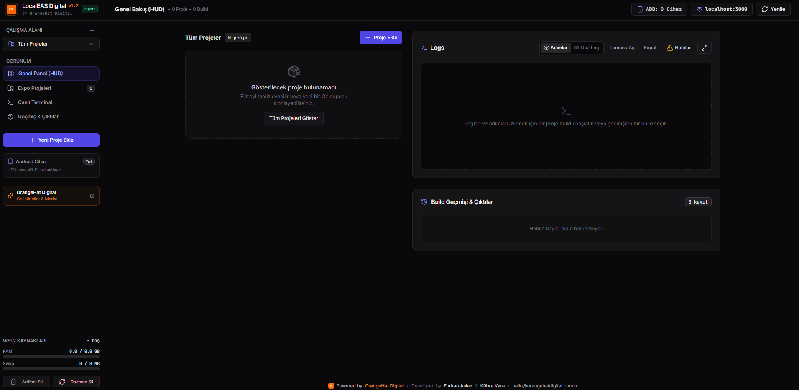
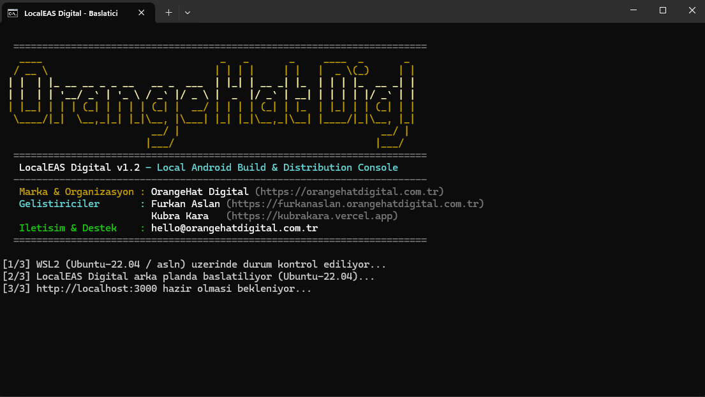

# LocalEAS Build Dashboard

<p align="center">
  
</p>

<p align="center">
  <b>Yerel Expo (EAS) Derleme ve Yönetim Paneli</b><br>
  <i>Local Expo (EAS) Build Station & Artifact Manager</i>
</p>

<p align="center">
  <a href="#-türkçe-dokümantasyon">🇹🇷 Türkçe</a> •
  <a href="#-english-documentation">🇬🇧 English</a>
</p>

---

<p align="center">
  
</p>
<p align="center">
  <em>📱 <b>Uygulama İçi Görünüm:</b> Proje Yönetim Paneli, Donanım Telemetrisi ve Hızlı Aksiyonlar</em>
</p>

<br />

<p align="center">
  
</p>
<p align="center">
  <em>⚡ <b>Çalışma Görünümü:</b> Canlı Log Akışı, Süre Sayaçları ve Aşama Takip Terminali</em>
</p>

---

<a id="-türkçe-dokümantasyon"></a>
## 🇹🇷 Türkçe Dokümantasyon

### 📌 Proje Nedir?
**LocalEAS Dashboard**, React Native ve Expo ile geliştirilen mobil uygulamaların Android derlemelerini (`.apk` ve `.aab`) kendi bilgisayarınızda (WSL2 / Linux) yerel olarak almanızı sağlayan, modern ve mobil uyumlu bir yönetim paneli arayüzüdür.

EAS Cloud ücretsiz paketindeki derleme sınırlarına (aylık kota ve uzun bekleme sıraları) takılmadan, doğrudan kendi donanımınızın gücüyle sınırsız derleme yapmanızı sağlar.

---

### ✨ Temel Özellikler

* **Yerel EAS Derleme:** `eas build --platform android --local` komutunu arka planda optimize edilmiş ortam değişkenleriyle yönetir.
* **Tek Derleme Kuyruk Yöneticisi (Anti-OOM):** WSL2'nin Gradle çökmesini önlemek için aynı anda sadece 1 derlemeye izin veren tekil kuyruk mekanizması.
* **Canlı Log Akordeonu:** Derleme aşamalarını (`Bağımlılık Kurulumu`, `Prebuild`, `Gradle Derleme`, `Paketleme`) Expo.dev tarzı süre sayaçlarıyla ve adım adım gösterir.
* **Tek Tıkla ADB Kurulumu:** USB veya Wi-Fi üzerinden bağlı fiziksel Android telefonları ve emülatörleri algılayıp üretilen APK'yı anında cihaza kurar.
* **Wi-Fi QR Kod ile İndirme:** Telefon kamerasıyla QR kodu taratarak yerel ağ üzerinden APK'yı doğrudan telefona indirme imkanı.
* **Donanım Telemetrisi:** Gerçek zamanlı WSL2 RAM, Takas Alanı (Swap) ve disk kullanımını gösteren kontrol çubuğu.
* **Proje ve app.json Editörü:** `builds/` dizinindeki projeleri otomatik tarar; Uygulama Adı, Paket Adı (`com.example.app`), Sürüm ve VersionCode değerlerini arayüzden düzenlemeyi sağlar.
* **Otomatik Temizlik:** Zombi derleyici süreçlerini ve eski derleme çıktılarını tek tıkla temizleme.

---

### 📋 Gereksinimler (Ubuntu 22.04 / WSL2)

| Bileşen | Önerilen Sürüm | Açıklama |
| :--- | :--- | :--- |
| **İşletim Sistemi** | Windows 10/11 WSL2 (Ubuntu 22.04) veya Yerel Linux | Yerel dosya sistemi performansı için |
| **Node.js** | v18.x, v20.x veya v22.x | NVM ile kurulum önerilir |
| **Java JDK** | OpenJDK 17 | React Native & Gradle için zorunlu |
| **Android SDK** | Command-line Tools + Build-Tools 34+ | Platform araçları (`adb`) dahil |
| **EAS CLI** | Güncel Sürüm | `npm install -g eas-cli` |

---

### 🛠️ Sıfırdan Adım Adım Kurulum Rehberi (WSL2 / Linux)

#### 1. Temel Sistem Paketleri ve Java Kurulumu
```bash
sudo apt update && sudo apt upgrade -y
sudo apt install -y curl wget git unzip zip openjdk-17-jdk build-essential
```

#### 2. Node.js Kurulumu (NVM ile)
```bash
curl -o- https://raw.githubusercontent.com/nvm-sh/nvm/v0.40.1/install.sh | bash
source ~/.bashrc
nvm install 22
nvm use 22
```

#### 3. EAS CLI Kurulumu
```bash
npm install -g eas-cli
```

#### 4. Android SDK Kurulumu
```bash
mkdir -p ~/android-sdk/cmdline-tools
cd ~/android-sdk/cmdline-tools
wget https://dl.google.com/android/repository/commandlinetools-linux-11076708_latest.zip
unzip commandlinetools-linux-*_latest.zip
rm commandlinetools-linux-*_latest.zip
mv cmdline-tools latest

# Ortam değişkenlerini ~/.bashrc dosyasına ekleyin
cat << 'EOF' >> ~/.bashrc
export ANDROID_HOME=$HOME/android-sdk
export ANDROID_SDK_ROOT=$HOME/android-sdk
export PATH=$PATH:$ANDROID_HOME/cmdline-tools/latest/bin:$ANDROID_HOME/platform-tools:$ANDROID_HOME/build-tools/34.0.0
EOF

source ~/.bashrc

# Lisansları onaylayıp gerekli araçları indirin
yes | sdkmanager --licenses
sdkmanager "platform-tools" "platforms;android-34" "build-tools;34.0.0"
```

#### 5. WSL2 Bellek Sınırını & Çökmeleri Önleme (Önemli)
Gradle ve C++ derleyicilerinin bellek yetersizliğinden çökmesini engellemek için Windows kullanıcı dizininizde (`C:\Users\<KullanıcıAdınız>\.wslconfig`) dosyasını oluşturun veya düzenleyin:

```ini
[wsl2]
memory=8GB
swap=12GB
localhostForwarding=true
```

PowerShell'de şu komutu çalıştırarak WSL'i yeniden başlatın:
```powershell
wsl --shutdown
```

---

### 🚀 Paneli Çalıştırma

```bash
# Bağımlılıkları yükleyin
npm install

# Örnek konfigürasyon dosyasını oluşturun
cp .env.example .env.local

# Üretim modu için derleyin ve başlatın (Önerilen)
npm run build
npm run start
```

Tarayıcınızda **`http://localhost:3000`** adresine gidin.

Windows kullanıcıları için `scripts/` klasöründe tek tıkla başlatan **`scripts/Dashboard-Baslat.bat`** ve durduran **`scripts/Dashboard-Durdur.bat`** betikleri bulunmaktadır.

---

### 📂 Projelerinizi Ekleme & GitHub Yapılandırması

LocalEAS Digital, React Native / Expo projelerinizi iki farklı yöntemle çalışma alanına bağlayabilir:

#### 1. Panel Üzerinden Klonlama (Önerilen)
Panelin sol menüsündeki veya projeler sekmesindeki **"Yeni Proje Klonla"** butonuna tıklayarak projenizin Git adresini (`https://github.com/...` veya `git@github.com:...`) yapıştırıp tek tıkla WSL2 derleme dizinine klonlayabilirsiniz.

#### 2. Doğrudan WSL2 Dizinine Klonlama
Projelerinizi doğrudan Linux terminali üzerinden `BUILDS_ROOT` (varsayılan: `~/builds`) dizinine klonlayabilirsiniz. Dashboard yeni projeleri otomatik olarak algılar:
```bash
cd ~/builds
git clone https://github.com/kullaniciadi/projeniz.git
```

#### 🔑 Özel (Private) GitHub Repoları İçin Giriş Yapma
Özel (gizli) repolarınızı klonlayabilmek ve panel üzerinden `Git Pull` işlemlerini sorunsuz yürütebilmek için WSL2/Ubuntu içinde bir kez GitHub yetkilendirmesi yapmanız gerekir:

* **Yöntem A: GitHub CLI ile Giriş (En Kolay & Önerilen):**
  ```bash
  # GitHub CLI yüklü değilse kurun
  sudo apt update && sudo apt install gh -y

  # Giriş yapın (Tarayıcıdan tek kullanımlık onay kodu ile)
  gh auth login
  ```
  *(Seçenek adımları: `GitHub.com` -> `HTTPS` veya `SSH` -> `Login with a web browser`)*

* **Yöntem B: SSH Anahtarı Tanımlama:**
  ```bash
  ssh-keygen -t ed25519 -C "epostaniz@example.com"
  cat ~/.ssh/id_ed25519.pub
  ```
  *(Terminalde basılan anahtarı kopyalayıp [GitHub Settings > SSH Keys](https://github.com/settings/keys) ekranına ekleyin.)*

---

### 🎮 Kullanım Kılavuzu & Temel İş Akışları

LocalEAS Digital arayüzü açıldığında, projelerinizi yönetmek, derleme başlatmak ve çıktıları cihazlara dağıtmak için şu iş akışlarını izleyebilirsiniz:

#### 1. Proje Seçimi ve Derleme Parametreleri
* **Hedef Mimari Seçimi (Architecture):**
  * `arm64-v8a` (Varsayılan - En Hızlı): Yalnızca modern fiziksel Android cihazları hedefler. Derleme süresini %60 kısaltır ve RAM tüketimini minimumda tutar.
  * `arm64-v8a, x86_64`: Hem fiziksel telefonlar hem de Windows Android Emülatörleri için derler.
  * `Tüm Mimariler (All)`: Google Play Store'a yüklenecek tam kapsamlı paketler içindir.
* **Otomatik Git Commit:** Projenizde kaydedilmemiş (`dirty`) değişiklikler varsa bu anahtar açıkken EAS build öncesi otomatik olarak küçük bir git commit atılır; böylece derleme takılmadan güvenle yürür.

#### 2. Derleme Başlatma (Build Butonları)
* **Dev APK:** Geliştirici istemcisi (`development client`) içeren debug APK paketi üretir.
* **Preview APK:** Doğrudan fiziksel telefona kurulabilen ve test kullanıcılarına dağıtılabilen standalone `.apk` çıktısı üretir.
* **Prod AAB:** Google Play Console'a yüklemeye hazır imzalı `.aab` (Android App Bundle) paketi oluşturur.

#### 3. Canlı Terminal & Aşama Göstergesi
* **Otomatik Aşama Takibi:** Canlı log akışı taranarak mevcut aşama görsel adımlarla belirtilir:
  `[Bağımlılıklar Yükleniyor]` ➔ `[Expo Prebuild]` ➔ `[Gradle / Native Derleme]` ➔ `[Paketleme Tamamlandı]`
* **Filtreleme & İptal:** İhtiyaç anında yalnızca hata/uyarı loglarına odaklanabilir veya takılan bir süreci **"Build İptal Et"** butonuyla güvenle sonlandırabilirsiniz.

#### 4. Çıktıların Dağıtımı & Telefona Kurulum
Derleme bittiğinde dosya otomatik olarak `Build Geçmişi ve Çıktılar` sekmesine düşer:
* **QR Kod ile Doğrudan İndirme:** QR kod butonuna basıp telefonunuzun kamerasıyla ekrandaki QR kodu okutun. Telefonunuz Wi-Fi üzerinden `.apk` dosyasını anında indirmeye başlar. *(IP adresinizi üst bardaki LAN Host alanından özelleştirebilirsiniz).*
* **Tek Tıkla ADB Kurulumu:** Telefonunuz USB ile veya Wi-Fi ADB ile bilgisayara bağlıysa, **"Kur"** butonuna basarak APK'yı telefonunuza kablosuz/kablolu anında yükleyebilirsiniz.
* **Windows Gezgininde Aç:** Çıktı dosyasına doğrudan Windows üzerinden erişmek için butona tıkladığınızda dosya Windows Explorer'da seçili olarak açılır.

#### 5. Sistem Sağlığı & Hızlı Bakım
* Sol panelin altındaki **WSL2 Kaynakları** kutusundan anlık RAM, Swap ve Disk kullanımını takip edebilirsiniz.
* **"Daemon Sil"** butonu arka planda belleği şişiren Gradle ve Kotlin süreçlerini sonlandırır.
* **"Artifact Sil"** butonu eski `.apk` ve `.aab` çıktılarını topluca temizleyerek disk alanı açar.
* Proje kartlarındaki üç nokta (`...`) menüsünden tek tıkla `Git Pull` veya `Bağımlılıkları Düzelt` çalıştırabilirsiniz.

#### 📸 Ekran Görüntüleri & Çalışma Önizlemesi

| 📱 1. Uygulama İçi Arayüz (Dashboard) | ⚡ 2. Çalışma & Canlı Terminal Görünümü |
| :---: | :---: |
| [](public/assets/ieasdigital.png) | [](public/assets/image.png) |
| *Tüm projeler, derleme profilleri, donanım kaynakları ve mimari seçimleri.* | *Canlı derleme aşamaları, gerçek zamanlı stdout/stderr akışı ve terminal çıktısı.* |

---

### 👨‍💻 Geliştiriciler & Marka

Bu proje **[OrangeHat Digital](https://orangehatdigital.com.tr/)** bünyesinde açık kaynak topluluğu için geliştirilmiştir.

* **Topluluk & Organizasyon:** [OrangeHat Digital](https://orangehatdigital.com.tr/)
* **Geliştirici:** [Furkan Aslan](https://furkanaslan.orangehatdigital.com.tr/)
* **Geliştirici:** [Kübra Kara](https://kubrakara.vercel.app/)
* **İletişim & Geri Bildirim:** Her türlü soru, geri bildirim, mesaj veya hata bildirimi için **[hello@orangehatdigital.com.tr](mailto:hello@orangehatdigital.com.tr)** adresinden bizimle iletişime geçebilirsiniz.

---
---

<a id="-english-documentation"></a>
## 🇬🇧 English Documentation

### 📌 Overview
**LocalEAS Dashboard** is an on-premise, self-hosted web console designed for React Native and Expo developers to execute, manage, and monitor local Android builds (`.apk` and `.aab`) inside WSL2 or Linux.

It provides an intuitive alternative to EAS Cloud, enabling unlimited builds without monthly quota restrictions or cloud queue latency.

---

### ✨ Highlights

* **Local EAS Build Engine:** Orchestrates `eas build --platform android --local` using pre-configured dynamic build environments.
* **Anti-OOM Concurrency Lock:** Strict single-build FIFO queue prevents memory exhaustion and Gradle daemon crashes on limited hardware.
* **Live Stepper & Log Stream:** Real-time stdout/stderr streaming with categorized stages, duration timers, and warning/error filtering.
* **Instant ADB Deployment:** Automatic detection of USB and Wi-Fi ADB devices for one-click installation directly to target hardware or emulators.
* **Wireless QR Downloader:** Direct mobile browser download via Wi-Fi QR code rendering.
* **Target Architecture Selection:** Optimize build times by compiling only for `arm64-v8a` (fastest), dual architecture, or complete bundles.
* **Telemetry Dashboard:** Live WSL2 memory, swap, disk space, and daemon status metrics.
* **Project Scanner:** Scans your projects directory, supports subfolder monorepos, and provides inline `app.json` configuration updates.

---

### 📋 System Prerequisites

* **Host System:** Windows 10/11 with WSL2 (Ubuntu 22.04+) or standalone Linux
* **Runtime:** Node.js v18+, v20+, or v22+ (via NVM recommended)
* **JDK:** OpenJDK 17
* **Android Tools:** SDK Command-line tools, platform-tools, build-tools (API 34+)
* **CLI:** Global `eas-cli` (`npm install -g eas-cli`)

---

### 🛠️ Quick Installation

```bash
# 1. Clone repository
git clone https://github.com/orangehatdigital-code/LocalEAS-Digital.git
cd LocalEAS-Digital

# 2. Install dependencies
npm install

# 3. Configure environment
cp .env.example .env.local

# 4. Build and start server
npm run build
npm run start
```

Navigate to **`http://localhost:3000`** in your browser.

For Windows users, convenient one-click scripts are available in **`scripts/Dashboard-Baslat.bat`** and **`scripts/Dashboard-Durdur.bat`**.

---

### 📂 Adding Projects & GitHub Authentication

LocalEAS Digital discovers and builds Expo React Native apps located inside your `BUILDS_ROOT` directory:

#### 1. In-App One-Click Clone (Recommended)
Click **"Yeni Proje Klonla"** from the sidebar or projects tab, paste your repository URL (`https://github.com/...` or `git@github.com:...`), and LocalEAS will clone it directly into your build workspace.

#### 2. Manual Clone in WSL2
Alternatively, clone repositories directly into `BUILDS_ROOT` (default: `~/builds`) via terminal. The scanner will automatically detect them:
```bash
cd ~/builds
git clone https://github.com/your-username/your-app.git
```

#### 🔑 Authenticating for Private GitHub Repositories
To clone and pull private repositories from WSL2, authenticate once inside Ubuntu:

* **Method A: GitHub CLI (Recommended):**
  ```bash
  sudo apt update && sudo apt install gh -y
  gh auth login
  ```
  *(Follow the terminal prompts: choose `GitHub.com` -> `HTTPS` or `SSH` -> `Login with a web browser`.)*

* **Method B: SSH Key Setup:**
  ```bash
  ssh-keygen -t ed25519 -C "your-email@example.com"
  cat ~/.ssh/id_ed25519.pub
  ```
  *(Copy the printed public key and paste it into [GitHub Settings > SSH Keys](https://github.com/settings/keys).)*

---

### 🎮 User Guide & Core Workflows

Once LocalEAS Digital is running on `http://localhost:3000`, the main dashboard is organized into an intuitive developer HUD:

#### 1. Project Management & Settings
* **Project Cards:** All detected Expo repositories inside `BUILDS_ROOT` (`~/builds`) are listed with their title, SDK version, Android package ID, git branch, and dirty status.
* **Target Architecture Selector:** Select your build architecture on the card before triggering:
  * `arm64-v8a` *(Default & Recommended)*: Compiles exclusively for modern physical Android devices. Up to **4x faster build time** and **drastically reduced RAM usage**.
  * `arm64-v8a,x86_64`: Supports both physical devices and Windows Android Studio emulators.
  * `All Architectures`: Builds a full universal bundle (best for production releases).
* **Auto-Commit Toggle:** Automatically creates a temporary commit for untracked/dirty git working trees before starting EAS build.

#### 2. Starting Builds
Click any of the build buttons on a project card:
* **"Dev APK"**: Executes `eas build --platform android --profile development --local` (includes Expo Dev Client).
* **"Preview APK"**: Generates a standalone release APK for testing and sideloading without Expo Go.
* **"Prod AAB"**: Compiles an Android App Bundle (`.aab`) ready for Google Play Store console upload.

#### 3. Real-Time Terminal & Pipeline Stepper
* When a build starts, switch to the **"Terminal"** tab or click the active build banner.
* **Pipeline Stepper:** Visual stages highlight progress in real time (`Dependencies` ➔ `Prebuild` ➔ `Gradle / Native Compile` ➔ `Packaging Artifact`).
* **Live Monospace Logs:** Real-time stdout/stderr stream with ANSI color rendering.
* **Log Filtering:** Quickly filter between `All Logs` and `Errors / Warnings`.
* **Cancel Build:** Safely terminates the detached Gradle process group in WSL2 without leaving orphan memory locks.

#### 4. Artifact Distribution & Mobile Testing
Completed builds appear in the **"Builds"** tab and right-hand history table:
* **Direct QR Code Download:** Click the QR button and scan the code with your mobile phone camera over Local Wi-Fi. The APK downloads directly to your device. *(Customize your LAN Host IP in the top telemetry bar if needed).*
* **One-Click ADB Deployment:** If your Android phone or emulator is connected via USB or Wi-Fi ADB, click **"Install"** to instantly push and launch the APK.
* **Open in Windows Explorer:** Opens the generated artifact in Windows Explorer for direct file management.

#### 5. System Health & Maintenance
* Monitor real-time WSL2 RAM, Swap, and Disk Space in the telemetry box.
* **"Clean Daemons"**: Instantly terminates idle Gradle and Kotlin daemons that hog WSL2 memory.
* **"Clean Artifacts"**: Purges older `.apk` and `.aab` builds to recover disk space.
* **Project Menu (`...`)**: Run `Git Pull` or `Fix Dependencies` with a single click.

#### 📸 Screenshots & Live Build Preview

| 📱 1. In-App Interface (Dashboard) | ⚡ 2. Live Build & Terminal View |
| :---: | :---: |
| [](public/assets/ieasdigital.png) | [](public/assets/image.png) |
| *Project overview, build profiles, WSL2 telemetry, and architecture selector.* | *Real-time pipeline steppers, stdout/stderr streaming, and build cancellation.* |

---

### 💡 WSL2 Memory Optimization (.wslconfig)

To prevent Gradle Out-Of-Memory (OOM) termination during intense C++ compilation, configure your `C:\Users\<Username>\.wslconfig`:

```ini
[wsl2]
memory=8GB
swap=12GB
localhostForwarding=true
```

Then restart WSL via PowerShell:
```powershell
wsl --shutdown
```

---

### 👨‍💻 Authors & Brand

Developed for the open-source community by **[OrangeHat Digital](https://orangehatdigital.com.tr/)**.

* **Community & Organization:** [OrangeHat Digital](https://orangehatdigital.com.tr/)
* **Developer:** [Furkan Aslan](https://furkanaslan.orangehatdigital.com.tr/)
* **Developer:** [Kübra Kara](https://kubrakara.vercel.app/)
* **Contact & Feedback:** For inquiries, feedback, bug reports, or suggestions, feel free to contact us at **[hello@orangehatdigital.com.tr](mailto:hello@orangehatdigital.com.tr)**.

---

### 📄 License
This project is open-source under the [MIT License](LICENSE).
Contributions, suggestions, and feedback are welcome!
